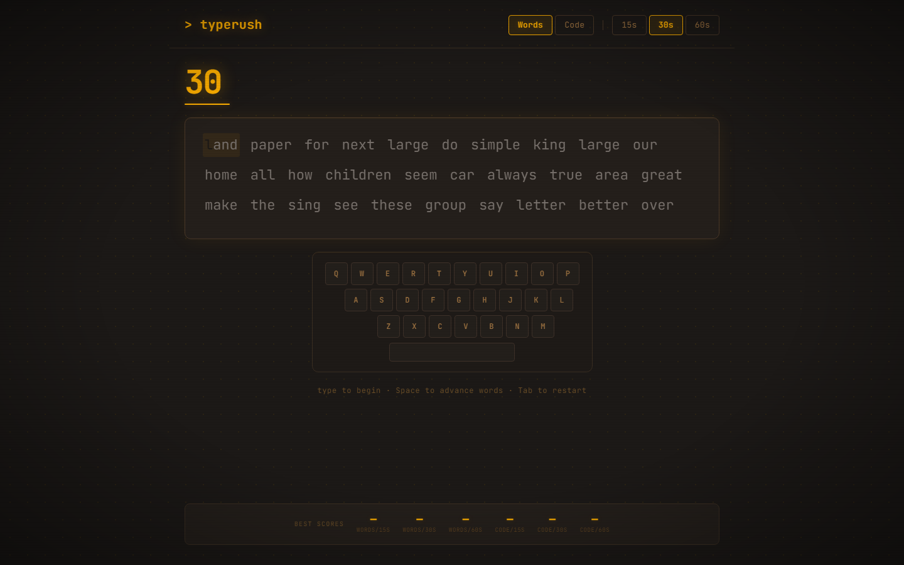
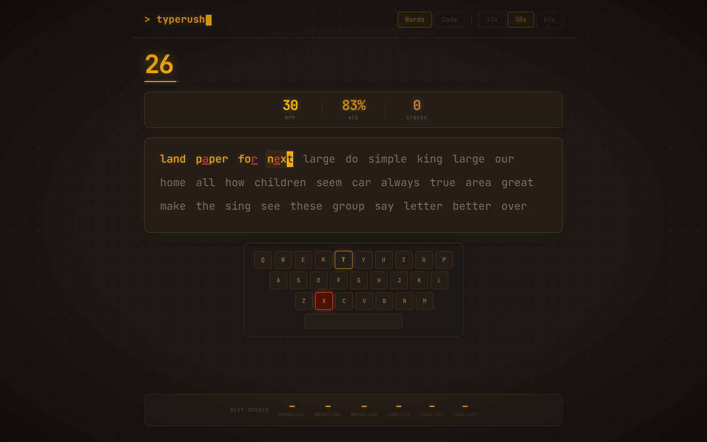
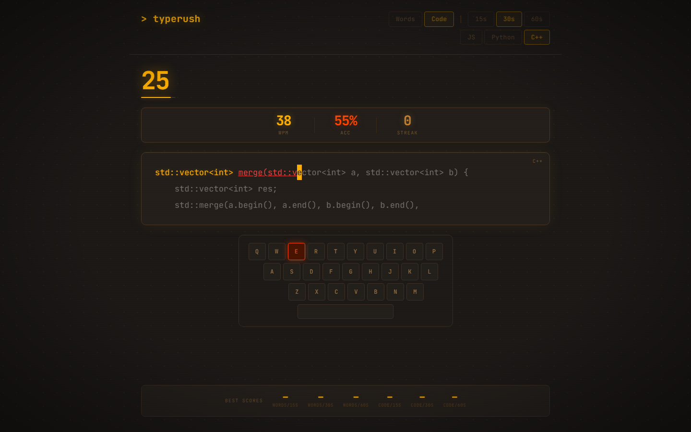
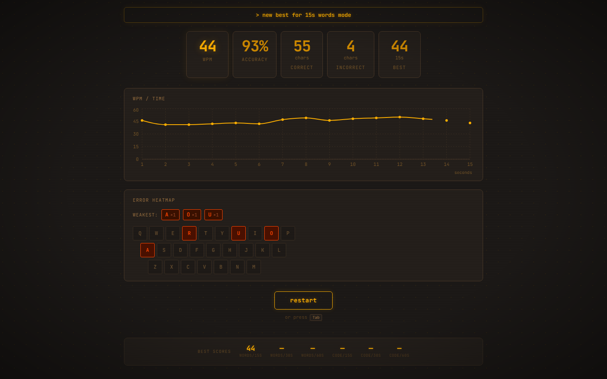

# TypeRush

## Project Title
**TypeRush** — A Real-Time Typing Speed Test

## Objective
Build an interactive typing speed test application that measures words per minute (WPM) and accuracy. Users select a time limit (15s, 30s, or 60s), type randomly generated common English words, and receive a detailed results breakdown including a WPM-over-time chart.

## Description
TypeRush is a retro terminal-themed typing speed test built with React and Vite. Amber (#FFB000) text on near-black, CRT scanline overlay, soft glow effects, and a block cursor give it an authentic terminal aesthetic.

### Modes
- **Words mode** — random common English words; Space to advance; block cursor follows each letter
- **Code mode** — real short code snippets in JavaScript, Python, or C++ (10 each); Enter for newlines; leading indentation is auto-skipped so the typist focuses on the code logic

### Features
- **Timer** starts on first keypress; choose 15s, 30s, or 60s
- **Live per-character highlighting** — amber for correct, red-orange for incorrect; block cursor
- **Mistype tracking** per character for the keyboard heatmap
- **Results screen**: WPM, accuracy %, correct/incorrect char counts, best score
- **WPM-over-time line chart** (Recharts)
- **Keyboard heatmap** — QWERTY layout with per-key colour intensity showing error frequency; top-3 weakest keys listed
- **Best score persistence** per mode (words/code × 15s/30s/60s) in localStorage
- **Restart** via button or Tab at any time
- CRT scanlines, corner vignette, text glow, blinking block cursor

### Component Structure
| File | Role |
|---|---|
| `src/hooks/useTypingTest.js` | All logic: dual-mode state, timer, WPM, mistype tracking, localStorage |
| `src/components/WordDisplay.jsx` | Word-by-word display with per-char states and block cursor |
| `src/components/CodeDisplay.jsx` | Multi-line code display, Enter-key cursor, auto-skipped indentation |
| `src/components/ModeSelector.jsx` | Words/Code tabs, language picker, time-mode buttons |
| `src/components/Timer.jsx` | Amber countdown with glowing progress bar |
| `src/components/Results.jsx` | Stat cards, WPM chart, keyboard heatmap, restart |
| `src/components/StatsChart.jsx` | Recharts line chart (amber palette) |
| `src/components/KeyboardHeatmap.jsx` | QWERTY heatmap with intensity-coded mistype colours |

## Tools / Technologies
| Tool | Version | Purpose |
|---|---|---|
| React | 19 | UI components, hooks, state management |
| Vite | 8 | Build tool and HMR dev server |
| Tailwind CSS | 4 | Utility-first styling via `@tailwindcss/vite` plugin |
| Recharts | 3 | WPM-over-time line chart |
| JavaScript (ES2022) | — | Application logic, event handling |
| CSS `@keyframes` | — | Blink animation, fade-in, CRT vignette |
| localStorage API | — | Persisting best scores (words/code × 15s/30s/60s) |

## Execution Steps

### Prerequisites
- Node.js 18+ installed
- npm 9+

### Steps
```bash
# 1. Clone or download the repository
git clone <repo-url>
cd typerush

# 2. Install dependencies
npm install

# 3. Start the development server
npm run dev

# 4. Open in browser
# Navigate to http://localhost:5173
```

### Build for production
```bash
npm run build
npm run preview
```

## Output

| | |
|:---:|:---:|
|  |  |
| *Start screen — Words mode, 30 s, live keyboard ready* | *Mid-test — amber glow (correct), red underline (wrong), gray (untyped), keyboard lit* |
|  |  |
| *Code mode — C++ snippet with typed and untyped characters* | *Results — WPM over time chart and per-key error heatmap after a 15 s run* |
